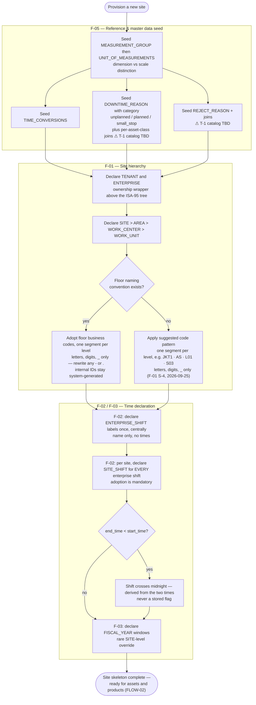

# FLOW-01 — Site skeleton provisioning (A-1a)

> Working draft (`foundation-domain`). Series index: [00-flow.md](00-flow.md) — notation,
> IEC 62264-3 mapping, and traceability live there. Structural counterpart:
> [F-00 data map](../DOCS-EN/00-foundation.md). Continues into
> [FLOW-02 — production readiness](02-production-readiness.md).

**Status:** 🟡 DRAFT — first cut, needs PO review.

Single actor (implementor). First half of provisioning: reference data, the site tree, and
time context — the load-bearing skeleton every other module attaches to. Phase order
mirrors the **F-00 "Next step" reading order** — the repo's documented dependency order —
labeled with its DOCS-EN module number. Note this is deliberately *not* raw numeric order:
F-00 explains Reference & Master Data (F-05) must come first because Equipment Taxonomy's
join tables and Product's UOM foreign keys point at it. Seed steps inside F-05 can run in
any order relative to each other.

Split from the original single-diagram FLOW-01 (2026-08-26) — see [00-flow.md](00-flow.md)
open questions for the split rationale. Continues in
[FLOW-02](02-production-readiness.md), which covers assets, products, KPI binding, and
work master (the parts of provisioning that need the skeleton to exist first).

Rules this flow enforces silently: internal IDs permanent and never reused; business codes
never foreign keys; seed catalogs (`DOWNTIME_REASON`, `REJECT_REASON`) are reviewed master
data, not hardcoded enums (2026-08-21 `MEASUREMENT_GROUP` decision).

## Design implications

Derived strictly from decided rules (tier 2 per [00-flow](00-flow.md)); each row stays
unpicked until a UX document declares the screen that satisfies it.

| Constraint (source) | Implication for any screen | Picked up by |
|---|---|---|
| SITE_SHIFT adoption is mandatory per enterprise shift ([02-shift core concept 1](../DOCS-EN/02-shift.md)) | Setup cannot offer "skip a shift"; per-shift completion state must be visible | `SCR-FND-SHF-002` |
| `crosses_midnight` is derived, never stored ([02-shift §9.2](../DOCS-EN/02-shift.md)) | No checkbox; show the derived crossing as a hint once both times are set | `SCR-FND-SHF-002` |
| Floor business codes adopted unchanged when they exist ([00-foundation §ID rules](../DOCS-EN/00-foundation.md)) | Code fields accept free text with the suggested pattern as a hint, never a locked format | `SCR-FND-SIT-001` |
| Deactivation with open transactions is rejected, naming the blocker ([00-foundation](../DOCS-EN/00-foundation.md)) | Every reject state renders the blocking entity as a navigable link, not a code | `SCR-FND-SIT-002` |
| Reason/UOM catalogs are reviewed master data, not enums (2026-08-21 `MEASUREMENT_GROUP` decision) | Seed screens are reviewable CRUD lists, not settings-page enum pickers | `SCR-FND-REF-001` |
