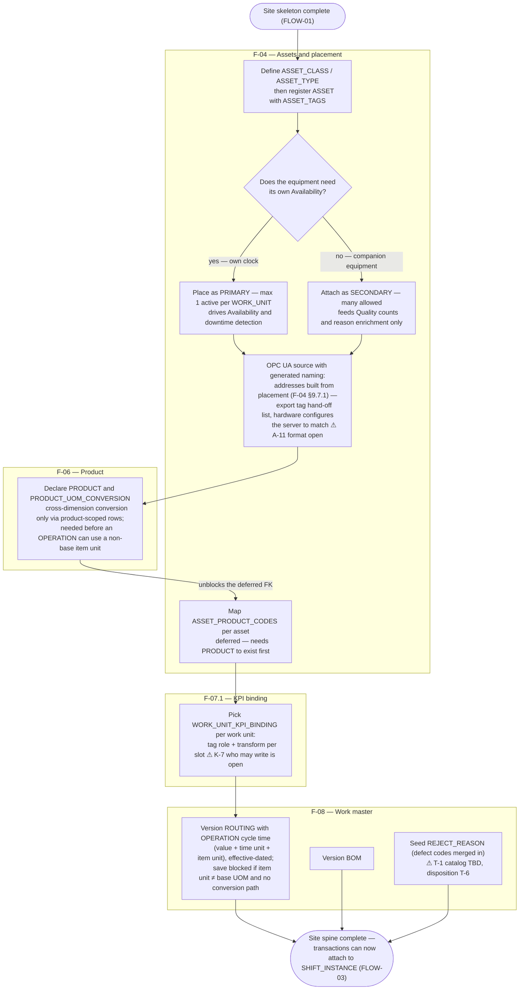

# FLOW-02 — Production readiness provisioning (A-1b)

> Working draft (`foundation-domain`). Series index: [00-flow.md](00-flow.md) — notation,
> IEC 62264-3 mapping, and traceability live there. Structural counterpart:
> [F-00 data map](../DOCS-EN/00-foundation.md). Continues from
> [FLOW-01 — site skeleton](01-site-skeleton.md).

**Status:** 🟡 DRAFT — first cut, needs PO review.

Single actor (implementor). Second half of provisioning: assets and their placement,
products, KPI tag binding, and work master — everything that needs the site skeleton
(tenant/site/area/work unit, shift, fiscal year) to exist first. The one edge the F-00
reading order cannot express — `ASSET_PRODUCT_CODES.product_id` FKs into `PRODUCT` (F-06,
read *after* F-04) — is drawn explicitly as a deferred mapping step.

Split from the original single-diagram FLOW-01 (2026-08-26) — see [00-flow.md](00-flow.md)
open questions for the split rationale.

## Design implications

Derived strictly from decided rules (tier 2 per [00-flow](00-flow.md)); each row stays
unpicked until a UX document declares the screen that satisfies it.

| Constraint (source) | Implication for any screen | Picked up by |
|---|---|---|
| Reason/UOM catalogs are reviewed master data, not enums (2026-08-21 `MEASUREMENT_GROUP` decision) | Downtime-reason class joins are a reviewable CRUD list, not a settings-page enum picker | `SCR-FND-AST-004` |
| Generated OPC UA addresses come from placement; the server is configured to match the hand-off list, not the reverse ([F-04 §9.7.1](../DOCS-EN/04-asset-ontology.md#971-generated-opc-ua-node-address), 2026-09-25) | Tag list shows the address read-only, "no address" for an unplaced machine, and offers the hand-off list export; placing or moving a machine says a new list is needed | `SCR-FND-DSR-001`, `SCR-FND-AST-001` |
| Multi-lane machine: several active placements only as an explicit "add a lane", same site; each per-lane tag assigned to one work unit ([F-04 §9.6/§9.7](../DOCS-EN/04-asset-ontology.md#96-asset-to-work-unit-placement-rules), 2026-09-25) | Place/swap asks move vs add a lane; tag form asks for the lane when the machine has more than one | `SCR-FND-AST-001`, `SCR-FND-DSR-001` |
| `ASSET_PRODUCT_CODES` needs `PRODUCT` to exist (deferred FK, this diagram) | Product codes are mapped on the product's Routing tab once the product exists; before that, the step shows as deferred with the reason visible | `SCR-FND-WMS-007` (was the retired `SCR-FND-AST-002`, 2026-09-30) |
| `WORK_UNIT_KPI_BINDING` must pick a `KPI_PARAMETERS`-legal combination per slot ([F-07.1 §9.4](../DOCS-EN/07-1-kpi-tag-mapping.md)) | Binding editor only offers legal tag-role/transform combinations, with a worked preview; rejects an undeclared tag by naming it | `SCR-FND-KPI-002` |
| `OPERATION.uom_id` is the item unit; a non-base unit needs a `PRODUCT_UOM_CONVERSION` path on `valid_from` ([F-08 §9.2.1](../DOCS-EN/08-work-master.md#921-item-unit-and-conversion-po-2026-09-28), 2026-09-28) | Operation editor enters cycle time as value + time unit + item unit, offers only convertible item units, and blocks save naming the missing conversion | `SCR-FND-WMS-003` |
| Versioned routing/BOM lock at work-order release, not at edit time ([08-work-master](../DOCS-EN/08-work-master.md)) | Routing/BOM editors show which version is currently *live* vs *locked into open work orders* | `SCR-FND-WMS-003` |
