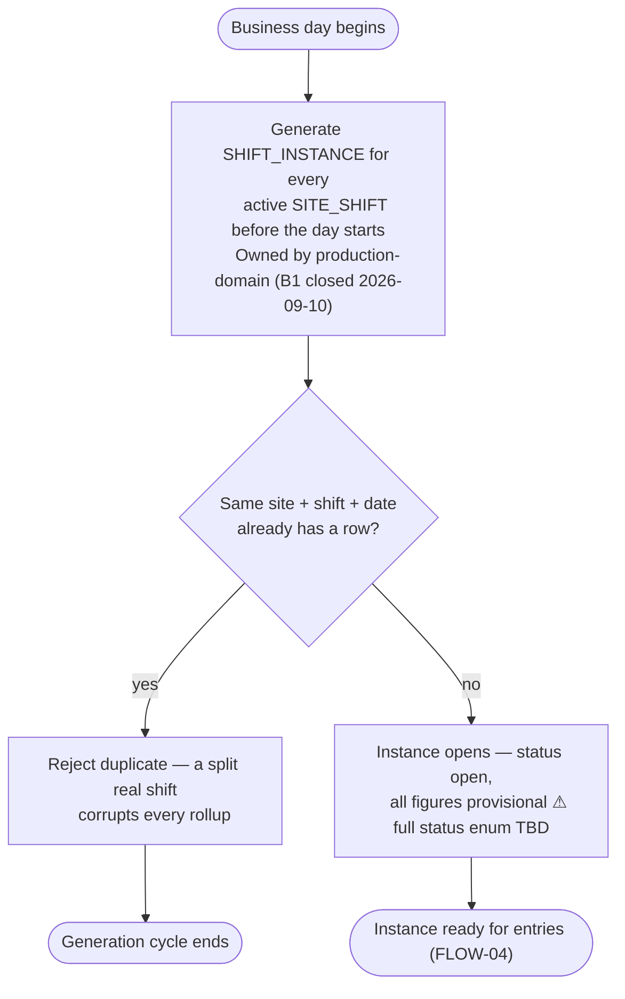

# FLOW-03 — Shift-instance generation (A-2a)

> Working draft (`foundation-domain`). Series index: [00-flow.md](00-flow.md) — notation,
> IEC 62264-3 mapping, and traceability live there. Time rules:
> [02-shift](../DOCS-EN/02-shift.md).

**Status:** 🟡 DRAFT — first cut, needs PO review. Mechanism owner is `production-domain`,
**confirmed** ([B1 closed, 2026-09-10](../../../LOGS/decisions/2026-09-10-b1-shift-instance-generator-owner.md)),
not FOUNDATION — this diagram documents only the FOUNDATION-decided rules the job must
respect (one row per site+shift+date, no silent overwrite). One generator; the
`SHIFT_INSTANCE` rows it creates are read by every MOM domain that needs shift/time
context, never regenerated per domain.

Split out of the original single-diagram FLOW-02 (2026-08-26): generation is a recurring,
unattended precondition, not part of the operator's daily loop — see
[FLOW-04 — daily runtime](04-daily-runtime.md) for what happens once an instance is open,
and [00-flow.md](00-flow.md) open questions for the split rationale.

## Design implications

Derived strictly from decided rules (tier 2 per [00-flow](00-flow.md)); each row stays
unpicked until a UX document declares the screen that satisfies it. This job is
unattended — its implications are for a monitoring/ops screen, not an implementor wizard.

| Constraint (source) | Implication for any screen | Picked up by |
|---|---|---|
| Duplicate site+shift+date generation must be rejected, not merged ([02-shift](../DOCS-EN/02-shift.md)) | A gap or duplicate in generation must be visible somewhere with the reason, not silently dropped or silently doubled | `TBD` — no screen owns shift-instance generation monitoring yet; `production-domain` owns building one (H-6, confirmed [2026-09-10](../../../LOGS/decisions/2026-09-10-b1-shift-instance-generator-owner.md)) |
