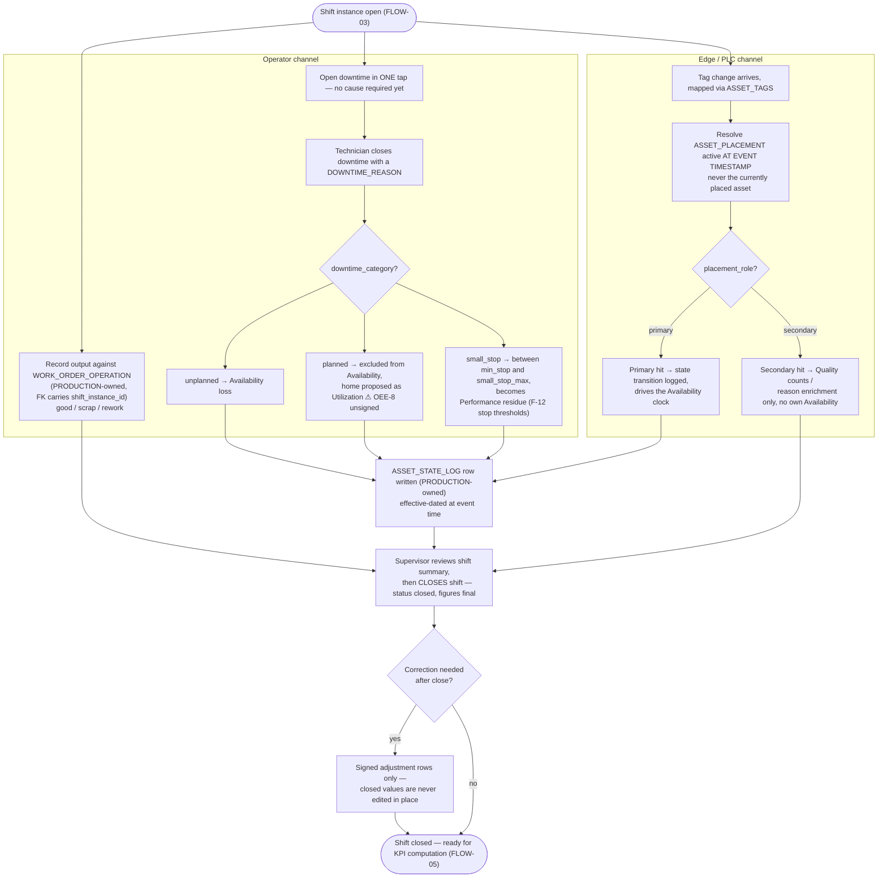

# FLOW-04 — Daily operator/PLC entry loop (A-2b)

> Working draft (`foundation-domain`). Series index: [00-flow.md](00-flow.md) — notation,
> IEC 62264-3 mapping, and traceability live there. Time rules:
> [02-shift](../DOCS-EN/02-shift.md) · placement rules: [04-asset-ontology](../DOCS-EN/04-asset-ontology.md).
> Precondition: [FLOW-03 — shift generation](03-shift-generation.md). Downstream:
> [FLOW-05 — KPI computation](05-kpi-computation.md).

**Status:** 🟡 DRAFT — first cut, needs PO review.

Once an instance is open (FLOW-03), everything that produces a number attaches to it
(`shift_instance_id`). Two collection channels run concurrently during the shift — manual
operator entries and PLC tag changes resolved through placements **as of the event timestamp,
never the currently placed asset**.

Split out of the original single-diagram FLOW-02 (2026-08-26): the shift-generation
precondition moved to [FLOW-03](03-shift-generation.md), and downstream KPI computation
moved to [FLOW-05](05-kpi-computation.md) — see [00-flow.md](00-flow.md) open questions for
the split rationale.

Notes: `Utilization` (planned-downtime home) is an **unsigned proposal** — see
[P-02 §2.1](../../PRODUCTION/DOCS/03-performance.md) and open question OEE-8 before building
anything on that branch. The small-stop thresholds (`min_stop_seconds`, `small_stop_max_seconds`, per work center with work unit override) are set in [F-12 Configuration Service](../DOCS-EN/12-configuration-service.md#confirmed-first-release-item-stop-thresholds-po-2026-10-01) (PO, 2026-10-01); a stop shorter than `min_stop_seconds` is not a stop at all and counts as speed loss.

**Cross-domain note, 2026-09-03:** `WORK_ORDER_OPERATION` is owned by **PRODUCTION**
(Job Schedule module), not FOUNDATION — moved out of F-08 per the [2026-09-03 contest-review
decision](../../../LOGS/decisions/2026-09-03-foundation-contest-blockers.md). This diagram
cites it only as the FK target the operator-channel entry writes to (`shift_instance_id`
context comes from FOUNDATION's `SHIFT_INSTANCE`); its full field set, including the
defect-code split (`scrap_qty`/`rework_qty` now derived from child
`WORK_ORDER_OPERATION_DEFECT` rows, not entered directly), is specified in
[01-planning.md § WORK_ORDER_OPERATION](../../PRODUCTION/DOCS/01-planning.md#work_order_operation--execution-and-output-per-shift),
not here.

## Design implications

Derived strictly from decided rules (tier 2 per [00-flow](00-flow.md)); each row stays
unpicked until a UX document declares the screen that satisfies it. FOUNDATION only lists
implications whose constraint is a FOUNDATION-owned rule — the operator-channel entry UI
(one-tap downtime open, category consequence display) is `production-domain`'s own
derivation from its docs, not restated here; see a future PRODUCTION FLOW doc.

| Constraint (source) | Implication for any screen | Picked up by |
|---|---|---|
| Placement resolved at event timestamp, never current ([07-1 walkthrough](../DOCS-EN/07-1-kpi-tag-mapping.md)) | Historical state rows display the asset-as-of-event; a "current asset" view must not be used to explain them | ~~`SCR-FND-AST-005`~~ retired 2026-09-28 — now `SCR-PROD-MON-001` in [PRODUCTION Monitoring](../../PRODUCTION/DOCS/02-monitoring.md#asset_state_log--operational-state-per-asset-over-time) (`ASSET_STATE_LOG` is PRODUCTION-owned, [decision 2026-09-28](../../../LOGS/decisions/2026-09-28-asset-status-ownership.md)) |
| Open-shift figures are provisional; closed are final ([02-shift core concept 7](../DOCS-EN/02-shift.md)) | Every number carries a provisional/final marker plus `has_corrections` and `last_updated` indicators | `SCR-PROD-OEE-001…005` — PROD UX doc pending (PO, 2026-08-26) |
| Post-close corrections are signed adjustments, never edits ([02-shift](../DOCS-EN/02-shift.md)) | Closed data has no edit affordance; only an "add adjustment" affordance with reason | `SCR-PROD-SHF-008` — PROD UX doc pending (PO, 2026-08-26) |
