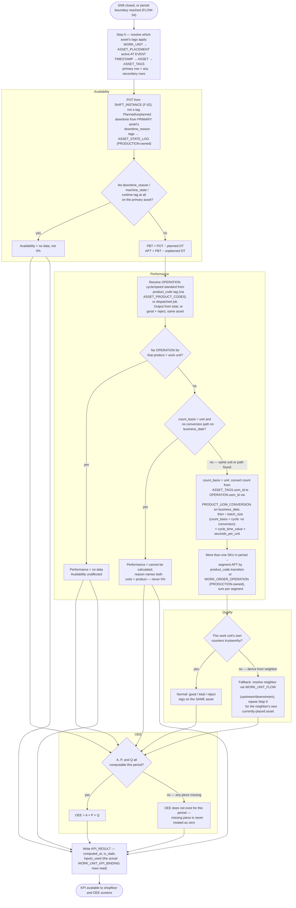
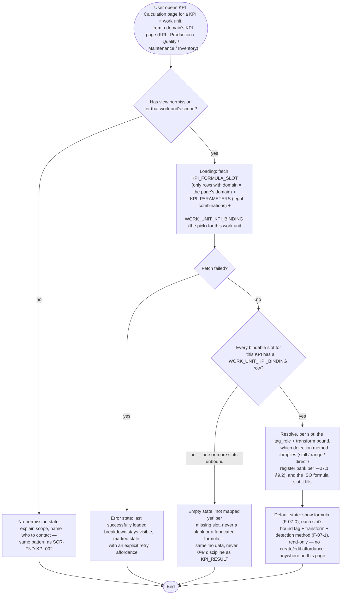

# FLOW-05 — KPI computation (A-2c)

> Working draft (`foundation-domain`). Series index: [00-flow.md](00-flow.md) — notation,
> IEC 62264-3 mapping, and traceability live there. Formula source:
> [F-07.1 KPI tag mapping](../DOCS-EN/07-1-kpi-tag-mapping.md) §"How one work unit's KPI
> resolves from tags, end to end". Precondition: [FLOW-04 — daily runtime](04-daily-runtime.md).

**Status:** 🟡 DRAFT — first cut, needs PO review.

New in the split (2026-08-26): the original FLOW-02 ended in a single "downstream KPI
layer computes A/P/Q" box. F-07.1 §9 since gained a full entity spec
(`KPI_FORMULA_SLOT`, `KPI_PARAMETERS`, `WORK_UNIT_KPI_BINDING`, `KPI_RESULT`) and the
per-work-unit resolution walkthrough is non-trivial — it deserves its own diagram rather
than staying a single node. See [00-flow.md](00-flow.md) open questions for the split
rationale. Runs per work unit, per period, against data written during
[FLOW-04](04-daily-runtime.md).

**Cross-domain note, 2026-09-03:** `WORK_ORDER_OPERATION` cited as the multi-SKU segmentation
boundary is owned by **PRODUCTION** (Job Schedule module), not FOUNDATION — moved out of F-08
per the [2026-09-03 contest-review decision](../../../LOGS/decisions/2026-09-03-foundation-contest-blockers.md).
Its full spec is in [01-planning.md § WORK_ORDER_OPERATION](../../PRODUCTION/DOCS/01-planning.md#work_order_operation--execution-and-output-per-shift).

## Design implications

Derived strictly from decided rules (tier 2 per [00-flow](00-flow.md)); each row stays
unpicked until a UX document declares the screen that satisfies it.

| Constraint (source) | Implication for any screen | Picked up by |
|---|---|---|
| No data ≠ 0% — missing Availability/Performance/OEE inputs must read as "no data" ([F-07.1 walkthrough](../DOCS-EN/07-1-kpi-tag-mapping.md)) | Result screens distinguish "not computed" from an actual 0% value everywhere a KPI appears | `SCR-FND-KPI-003` |
| `KPI_RESULT` carries `computed_at` / `is_stale` / `inputs_used` ([F-07.1 §9.5](../DOCS-EN/07-1-kpi-tag-mapping.md)) | Freshness is never implied by a bare number; the actual bindings used for a result must be inspectable | `SCR-FND-KPI-003` |
| Counter unit ≠ `OPERATION.uom_id` is converted through `PRODUCT_UOM_CONVERSION`; no path on the `business_date` → "cannot be calculated" ([F-08 §9.2.1](../DOCS-EN/08-work-master.md#921-item-unit-and-conversion-po-2026-09-28), 2026-09-28) | The calculation breakdown shows the conversion **rule**, not live numbers (e.g. "Counter: pack → standard per carton: ÷ 12 (1 carton = 12 pack)"); a missing conversion reads "cannot be calculated: no pack ↔ carton conversion for \<product code\>", never 0% (PO 2026-09-28, [2026-09-28 decision](../../../LOGS/decisions/2026-09-28-work-master-per-domain-operation-uom.md); keys `kpi-004.conversion.*` in [UX 07](../UX/07-kpi.md#screen-text)) | `SCR-FND-KPI-004` |
| Multi-SKU periods segment by `product_code` transition, not averaged blind ([F-07.1 §"More than one SKU"](../DOCS-EN/07-1-kpi-tag-mapping.md)) | A period spanning a product change shows the segmentation, not one blended number | `SCR-PROD-OEE-001…005` — PROD UX doc pending (PO, 2026-08-26) |
| A work unit binds exactly one Availability-timing transform per slot — direct tag, register bank, stall, or range ([F-07.1 §9.2](../DOCS-EN/07-1-kpi-tag-mapping.md#92-transform-enum)) | A calculation-breakdown view names the one bound detection method, never lists all four as if several applied at once | `SCR-FND-KPI-004` |

## Activity: user opens the KPI Calculation page (view-only)

> **2026-09-28 (PO):** the KPI Calculation "page" is now **section 3 of the per-KPI side panel** on a
> domain's KPI page ([UX 07](../UX/07-kpi.md#kpi-page-cards-one-side-panel-per-kpi-po-decision-2026-09-28)),
> opened by clicking a KPI card. The activity below is unchanged: same checks, same states, still view-only;
> "opens the page" now means "opens the panel".

New activity, distinct from the calculation job above — this is a **read** of the same
config the job already resolves (`KPI_FORMULA_SLOT`, `KPI_PARAMETERS`,
`WORK_UNIT_KPI_BINDING`), not a second calculation path. No entity here is written; this
activity only decides what a viewer sees.

**Why view-only:** this page is a human-readable reflection of `KPI_FORMULA_SLOT` /
`KPI_PARAMETERS` / `WORK_UNIT_KPI_BINDING`, not a hand-authored document — the same
config `SCR-FND-KPI-001`/`SCR-FND-KPI-002` already write. A viewer who wants to change a
binding is routed to `SCR-FND-KPI-002` (or, for the closed catalog, to Product Owner via
`SCR-FND-KPI-001`'s existing "suggest change" affordance) — this page itself has no
create/edit path.

**One domain at a time (PO, 2026-09-27).** The page is reached from a domain's KPI page
([UX 07 KPI item inside each domain group](../UX/07-kpi.md#kpi-item-inside-each-domain-group-po-decision-2026-09-28))
and keeps that domain: it lists only KPIs whose slots have `KPI_FORMULA_SLOT.domain` = that
domain ([F-07.1 §9.1](../DOCS-EN/07-1-kpi-tag-mapping.md#91-kpi_formula_slot)). Today every slot
is `production`.

**Partial mapping is not an error.** [Metrics light up independently](../DOCS-EN/07-1-kpi-tag-mapping.md#metrics-light-up-independently)
already governs `KPI_RESULT`; the same rule applies to this page one layer up — Availability
can show its bound detection method while Performance's slot is still unbound and reads
"not mapped yet," never blocking the whole page.

### Design implications — KPI Calculation page

| Constraint (source) | Implication for any screen | Picked up by |
|---|---|---|
| `WORK_UNIT_KPI_BINDING` is mandatory per bindable slot, not an override beside automatic resolution ([F-07.1 §9.4](../DOCS-EN/07-1-kpi-tag-mapping.md#94-work_unit_kpi_binding)) | An unbound slot reads "not mapped yet," never inferred or left blank | `SCR-FND-KPI-004` |
| `KPI_FORMULA_SLOT`/`KPI_PARAMETERS` are never implementor-writable ([F-07.1 §9.3](../DOCS-EN/07-1-kpi-tag-mapping.md#93-kpi_parameters), K-1/K-7) | This page has no create/edit affordance anywhere; a "change this" action routes to `SCR-FND-KPI-001`/`SCR-FND-KPI-002`, it does not edit in place | `SCR-FND-KPI-004` |
| Exactly one Availability-timing transform is bound per work unit — stall, range, direct, or register bank ([F-07.1 §9.2](../DOCS-EN/07-1-kpi-tag-mapping.md#92-transform-enum)) | The breakdown names the single bound detection method plainly, not a menu of possibilities | `SCR-FND-KPI-004` |
