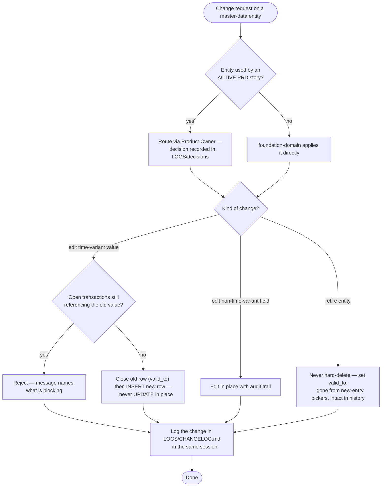

# FLOW-06 — Master-data change control (A-3)

> Working draft (`foundation-domain`). Series index: [00-flow.md](00-flow.md) — notation,
> IEC 62264-3 mapping, and traceability live there. Dating rules:
> [00-foundation §Effective dating](../DOCS-EN/00-foundation.md).

**Status:** 🟡 DRAFT — first cut, needs PO review. Renumbered from FLOW-03 in the 2026-08-26
series split — content unchanged; see [00-flow.md](00-flow.md) open questions.

Every change to modeled data passes the same gate: PRD-active entities detour through the
Product Owner; time-variant values close-and-open instead of updating; nothing is ever
hard-deleted while history points at it.

## Design implications

Derived strictly from decided rules (tier 2 per [00-flow](00-flow.md)); each row stays
unpicked until a UX document declares the screen that satisfies it.

| Constraint (source) | Implication for any screen | Picked up by |
|---|---|---|
| PRD-active entity changes route via Product Owner ([FOUNDATION/AGENTS §8](../AGENTS.md)) | The change UI has a submitted/decided state with the PO decision visible — never a silent apply | `TBD` — no module owns a change-approval screen yet (F-12 Configuration Service is concept-only); PRD-002 candidate |
| Time-variant edits close the old row and open a new one ([00-foundation §Effective dating](../DOCS-EN/00-foundation.md)) | Edit forms for time-variant entities carry validity-range fields and confirm "this closes the current record" | all effective-dated editors — canonical example `SCR-FND-WMS-003` |
| Rejections name what is blocking ([00-foundation](../DOCS-EN/00-foundation.md)) | Error states render the blocker as a navigable link, not a code | `SCR-FND-SIT-002` |
