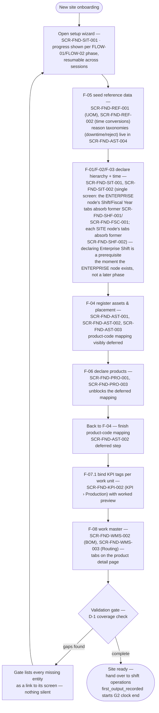

# UX-JRN 01 — Implementor site setup (journey)

> Composes: [UX 01](01-site-hierarchy.md)…[UX 08](08-work-master.md) ·
> behavior backbone: [FLOW-01](../FLOW/01-site-skeleton.md), [FLOW-02](../FLOW/02-production-readiness.md) · Status: 🟡 DRAFT.

**Persona:** internal implementor (PRD-001 §2, this quarter's target user) — desktop, long
sessions, stable network, tolerates dense screens when value and impact are clear.
**Trigger:** a new site or line goes live on MolcaDx.
**Success metric:** **G2** `waktu_setup_site_oleh_implementor` — full site setup until the
first output is recorded, **0 developer help, 0 code change** (PRD-001 §3). Events:
`master_data_setup_started` → `first_output_recorded`.

## Journey flow

## Wizard-level states (the journey itself)

| State | Behavior |
|---|---|
| Default | Phase progress bar mirrors FLOW-01 then FLOW-02 order; each phase shows its coverage status (D-1) |
| Resumed | Partial setup reopens at the first incomplete phase — no phase is silently skipped |
| Validation gate | Lists every missing entity as a navigable link; **nothing blocks silently** |
| Handover | Completion receipt names what is still `TBD` (e.g. real reason catalogs ⚠ T-1) so ops knows the caveats |

## Rules this journey obeys

- Phases appear in **FLOW-01 then FLOW-02 order** — the wizard may not reorder them (dependency-true).
- The wizard **composes** screens; it adds no fields of its own (rule D-3).
- The only hard gate is D-1 coverage; everything else stays editable later via
  [FLOW-06](../FLOW/06-change-control.md) change control.

## Open questions

| # | Question | Owner |
|---|---|---|
| UX-JRN-1 | May phases run in parallel tabs for a second implementor, or is setup single-threaded by design? | PO |
| UX-JRN-2 | Is the wizard also the *editing* home later, or does day-2 editing move to the module screens? | PO |
