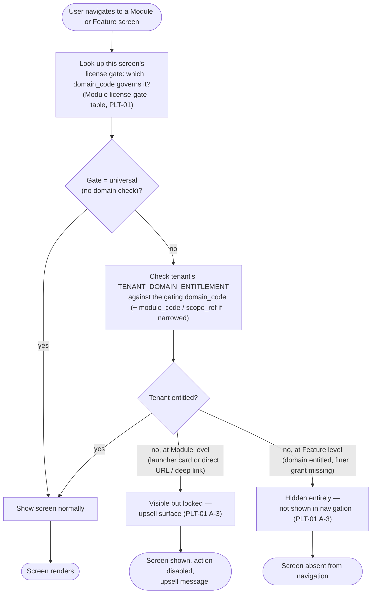
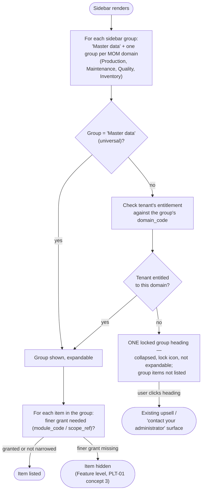

# FLOW-01 — Module entitlement check

> Working draft (`platform-domain`). First FLOW for PLATFORM — no series index (`00-flow.md`)
> yet, one file doesn't need one. Cited by any domain's `UX/` screen that is license-gated —
> see [PLT-01's module license-gate table](../DOCS-EN/01-license-manager.md#module-license-gate--data-ownership)
> for which screens that is. **Concept level** — this documents the check every gated screen
> performs, once, so individual domains' `UX/` docs cite it instead of redrawing it.

**Status:** 🟠 CONCEPT — describes the decided *behavior* (PLT-01 core concepts 1/3/3a/5), not a
built mechanism. `TENANT_DOMAIN_ENTITLEMENT` itself is still a sketch (PLT-01 §9).

### Sidebar render — domain groups (PLT-01 core concept 3a, 2026-09-28)

The sidebar is evaluated **per domain group**, before any per-item check. The screen-level
branch above still applies when the user reaches a screen by direct URL / deep link.

## Design implications

Derived strictly from decided rules (PLT-01 core concepts 1/3/3a/5); each row stays unpicked
until a UX document declares the screen that satisfies it.

| Constraint (source) | Implication for any gated screen | Picked up by |
|---|---|---|
| Module-level lock is discovery, Feature-level hide is scoping (PLT-01 core concept 3) | The **same missing entitlement** produces two different UI treatments depending on taxonomy level — a screen's `UX/` doc must say which level it is, not assume | Every domain's own `UX/*.md`, per screen |
| License gate ≠ data owner (PLT-01 core concept 5) | A screen's gate lookup is against the *gating* domain (e.g. Production for FOUNDATION's Work Master), never assumed to be the domain that owns the screen's data | `platform-domain` maintains the gate table; other domains cite it, never invent their own answer |
| `scope_ref` (data-level narrowing, PLT-01 A-4) | A tenant can be entitled to a Module but only for certain data (e.g. some `WORK_UNIT`s) — a "locked/hidden" decision may need to be evaluated **per row**, not just once per screen load | `TBD` — no domain has designed this list-level behavior yet; flag when a real screen needs it |
| Sidebar grouped by domain; unlicensed domain = one locked heading (PLT-01 core concept 3a, 2026-09-28) | The locked heading is the **only** upsell surface in navigation. Items of an unlicensed domain are never listed one by one, locked or hidden. Feature-level hide applies only inside a group the tenant is entitled to. A direct URL / deep link to a screen of an unlicensed domain still lands on the visible-but-locked screen state | Every domain's `UX/` doc that places an item in a domain group |
| Attribution (PLT-01 core concept 4) | Not part of this check itself — attribution is about *who changed* an entitlement, not about the runtime check a normal user's screen load performs | N/A here, see PLT-01 §9 `granted_by`/`granted_at` |

## What this FLOW is not

- **Not** the superadmin page's own flow (granting/revoking an entitlement) — that's
  `SCR-PLT-LIC-001` ([`UX/01-license-manager.md`](../UX/01-license-manager.md)), a different,
  not-yet-designed flow.
- **Not** a runtime/engineering design — no API, no caching strategy, no performance budget.
  `engineering-domain`'s concern once this behavior is scoped for real implementation.

## What's still unknown

| # | Question | Who needs to answer it |
|---|---|---|
| FL-1 | Is the entitlement check done once per navigation, or does it need to be re-checked live (e.g. an admin revokes access while the tenant's session is open)? | Product Owner + `engineering-domain` |
| FL-2 | `scope_ref`-level (per-row) locking — UI treatment not designed anywhere yet | Product Owner + `design-domain` |
| FL-3 | A tenant entitled to a domain but only to some of its Modules (PLT-01 concept 1): if every item in that domain's group is hidden, does the group show empty, disappear, or fall back to the locked heading? | Product Owner |
