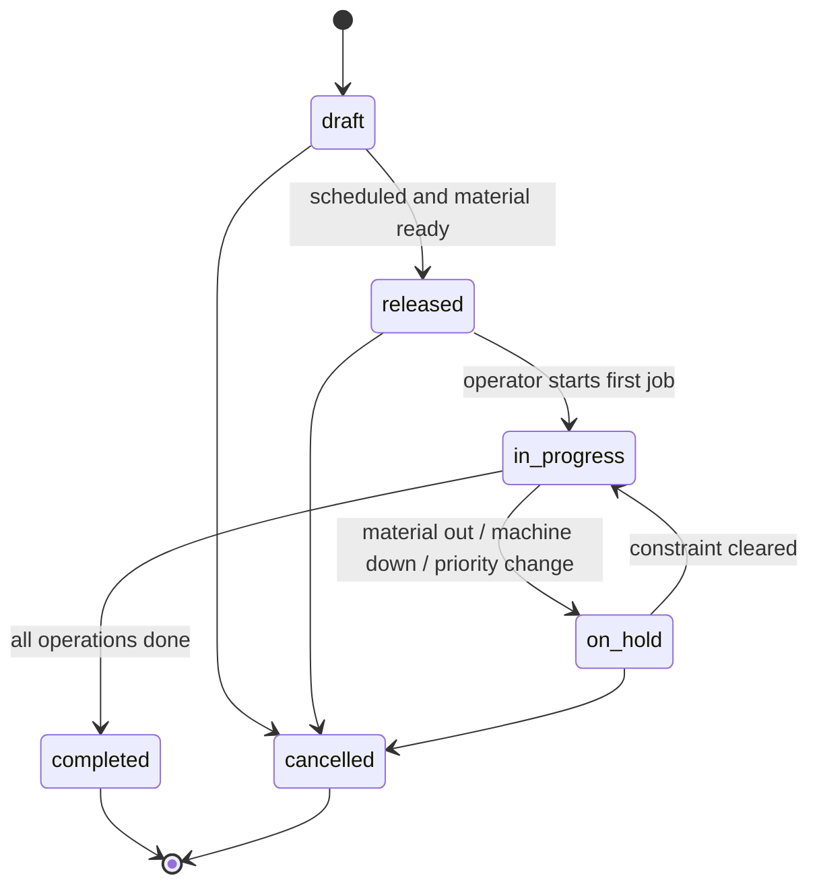

# PRODUCTION — Planning (“Next to be ERP”)

| | |
|---|---|
| **Module** | Production Planning |
| **Status** | 🟡 DRAFT |
| **Source** | Faris Figma, 2026-09-24; ot-it breaktime note 2026-09-24; Part-4 min spine |
| **Depends on** | FOUNDATION Work Master (F-08), Product/SKU (F-06), Site/Work Unit (F-01), Shift (F-02) |

---

## Purpose

Turn master routing and product into **schedules, dispatch, break windows, execution gates, and material→FG tracing** for the shop floor. Path toward ERP-grade order handling without inventing a second master-data model.

## Planning spine

Still:

**Work Master → Work Directive → Job Order (+ Job Response when close-in-scope).**

- Work Master / routing / cycle time: FOUNDATION F-08 (SoT). Production-facing definition: [05-work-master.md](05-work-master.md).
- Work Directive: ISA-95 / IEC 62264 Part-4 planning object — not yet an entity. Until it ships, `routing_version_locked` / `bom_version_locked` on `WORK_ORDER` stand in for it — see [05-work-master.md § Interim Directive-equivalent](05-work-master.md#interim-directive-equivalent-on-work_order) and the creator map there. Do not block Job Order on a full Workflow Spec.
- Job Order: PRODUCTION-owned transactional plan (entity historically `WORK_ORDER` / operations — keep that ownership; do not re-home to FOUNDATION).
- Schedule upload forms and multi-job lists = Work Schedule / Job List when needed; they **must not** replace or block the min spine.

## Job Order

### Upload schedule form (Figma)

Fields mirrored from the diagram:

- Schedule list
- SKU name (→ FOUNDATION product/SKU)
- Target
- Machine / Work Unit
- Timing / sequence
- Schedule approval
- Production notes
- Schedule time info

### Download form

- Schedule details
- Execution status: executed / not
- Target achievement

### Outputs

- Daily production schedules with priority (1st / 2nd / 3rd)
- Live achievement %
- Digital job dispatch to Work Units with queued prioritization

## Breaktime

### Forms & views

- Input: detailed break/rest per shift — **recurring** or **one-time**
- Output: **table** and **timeline** views

### Product rule — break vs unplanned (Faris + ot-it / ISO 22400-2)

| Clock concept | ISO home | Effect on Availability |
|---|---|---|
| Shift length − **authorized break/rest** | Fold into how **POT** is defined (time unit expected usable) | Break never appears as A/P/Q loss |
| Planned maintenance / reserved outage | **Planned downtime** → shrinks **PBT** | Denominator smaller |
| Breakdown / unplanned stop while expected to run | Unplanned → reduces **APT** | Numerator smaller |

**Do not:** set break as `downtime_category = unplanned`, or park unplanned loss “on” the break bar so break looks like the unplanned bucket.

**If unplanned overlaps a break window:** only the portion inside PBT expected run time reduces APT. Time inside authorized break was never in productive expectation — don’t double-count.

**One sentence:** Break/rest ⊂ calendar exclusion from POT (or equivalent); planned DT ⊂ PBT shrink; unplanned ⊂ APT shrink. **“Unplanned on break” ≠ classify break as unplanned.**

Cites (ot-it): ISO 22400-2 §5.1.2.2 POT, §5.1.2.4 PBT, Table 9 A=APT/PBT, §5.1.3.6 APT; APAT breaks excluded from attendance. Canonical Availability walk stays FOUNDATION F-07 (one chain: PBT = POT − planned downtime).

## Execution interlock / checklist

Before (or as) a Job Order runs on a Work Unit, gate on:

- Material availability
- Equipment readiness
- Personnel readiness
- Digital worknotes / instruction

Exact hard-block vs soft-warn per gate: TBD with PO/ops.

## Product tracing

Trace flow: **Material → WIP 1 → WIP 2 → FG**. Q3 records consumed/produced **lot IDs** on the job actual — see [Lot hook (Q3)](#lot-hook-q3--traceability-deferred-to-inventory). Inventory owns the lot record later; Production does not invent it here.

## Log (planning)

Who/when for schedule create, edit (before/after), delete, download (Figma).

**Storage (PO decision 2026-09-25):** this log is a **view of the shared FOUNDATION `AUDIT_LOG`** ([F-14](../../FOUNDATION/DOCS-EN/14-audit-trail.md)), filtered to `domain_code = PROD`, `module_code = PLN`. PRODUCTION has no log entity of its own.

- **Actions Planning writes:** generic `create`, `update`, `deactivate`, plus business actions `release`, `hold`, `resume`, `cancel`, `upload`, and `schedule_downloaded` when a user downloads a schedule (F-14 core concept 9 — no `changes`; `download_filter` + `download_row_count` instead). Downloading this log itself is a generic `download` row owned by FOUNDATION `AUD`. "Delete" in Figma maps to `deactivate` (no hard delete).
- **Permission:** read `production:pln:<scope>:audit_view`, download `production:pln:<scope>:audit_download` (e.g. `production:pln:site:audit_view`). Separate from permission to view the schedule itself.
- **Rules from F-14, not redefined here:** one row per change with before/after, written in the same transaction as the change, append-only (never edited or deleted), reason required when a person edits / deactivates / reactivates or takes a business action above (except `*_downloaded`), kept 3 years, actor display name kept.

## Entities

`WORK_ORDER` and `WORK_ORDER_OPERATION` are owned by PRODUCTION (this section).
`PRODUCT`, `ROUTING`, `OPERATION`, `BOM`, `BOM_LINE` stay in FOUNDATION Work Master (F-08);
`REJECT_REASON` stays in FOUNDATION Reference (F-05) — referenced by FK, never redefined here.
This section defines the **transactional structure** and **status behaviour**.

Faithful English carry-over of the former `job-schedule.md` §2.1–§2.5 (as on `main` after PR #31), plus the Q3 lot hook and the sensor-origin rule agreed 2026-09-24.

### WORK_ORDER — plan becomes a transaction

Moved from FOUNDATION F-08 §9.5 (see [structural decision](../../../LOGS/decisions/2026-09-03-foundation-contest-blockers.md)), with the B3 lock fields below.

| Field | Type | Required | Notes |
|---|---|---|---|
| `work_order_id` | internal ID | Yes | Permanent, never reused |
| `wo_number` | string | Yes | Business code, unique within a site |
| `product_id` | FK → `PRODUCT` (FOUNDATION, [Product §9.1](../../FOUNDATION/DOCS-EN/06-product.md#91-product--the-thing-being-made)) | Yes | |
| `routing_id` | FK → `ROUTING` (FOUNDATION, [Work Master §9.1](../../FOUNDATION/DOCS-EN/08-work-master.md#91-routing--a-product-can-run-at-this-work-center)) | Yes | Points at **one released version** of the routing (FOUNDATION versions `ROUTING`, one row per version — PLN-Q6, 2026-10-01). Picking it at release is the lock |
| `bom_id` | FK → `BOM` (FOUNDATION, [Work Master §9.3](../../FOUNDATION/DOCS-EN/08-work-master.md#93-bom--from-what-for-one-product)) | Yes | Points at **one released version** of the BOM (PLN-Q6, 2026-10-01). Picking it at release is the lock |
| `product_flow_id` | FK → `PRODUCT_FLOW` (FOUNDATION, [Work Master §9.0](../../FOUNDATION/DOCS-EN/08-work-master.md#90-product_flow--one-way-of-making-a-product-po-2026-09-30)) | Yes | **Added 2026-10-01 (PLN-Q7).** Which way of making the product this order follows. Default = the product's primary flow; only a `released` flow. `routing_id` and `bom_id` must belong to this flow |
| ~~`routing_version_locked`~~, ~~`bom_version_locked`~~ | — | — | **Removed 2026-10-01 (PLN-Q6).** Not needed: `routing_id` / `bom_id` already point at one version row |
| `planned_qty` | numeric | Yes | |
| `uom_id` | FK → `UNIT_OF_MEASUREMENTS` (FOUNDATION Reference) | Yes | |
| `planned_start`, `planned_end` | timestamp | Yes | Scheduling basis |
| `status` | enum | Yes | `draft` / `released` / `in_progress` / `on_hold` / `completed` / `cancelled` — see [WORK_ORDER status](#work_order-status) |
| `priority` | enum | No | Values `TBD` |
| `source_system` | string | No | Set when the WO comes from an ERP. See [Source of WORK_ORDER](#source-of-work_order-w-1b4--resolved-2026-09-12) — this field does not decide the source of truth |

**Keys** ([F-00 keys rule](../../FOUNDATION/DOCS-EN/00-foundation.md#keys-and-constraints-on-every-table-po-2026-10-01)): PK `work_order_id` · Unique: `wo_number` within a site (which stored column carries the site: see PLN-Q10; across ERPs `TBD`, W-1/B4 point 3) · No overlap: —

#### Routing/BOM locked at release (B3)

> **Resolved 2026-10-01 (PLN-Q6, PO).** FOUNDATION now versions `ROUTING` and `BOM` with one row per version
> (`version` + `status`, [F-08 versions and status](../../FOUNDATION/DOCS-EN/08-work-master.md#versions-and-status-po-2026-09-30)).
> The lock is simply the `routing_id` / `bom_id` picked at release; only `released` versions can be picked. The two
> placeholder fields below are removed. Standards (cycle time, speed) are still read as of the shift's date, not as of
> release (FOUNDATION issue #58 Q1). Text below kept for history.

**Problem:** `routing_id` / `bom_id` lock to a particular `ROUTING` / `BOM` *row*, but that row may be a stable identity while its contents (`OPERATION` steps under `ROUTING`, `BOM_LINE` components under `BOM`) change via separate effective-dated versions (`valid_from` / `valid_to`) after the WO is released. Without an explicit lock, a running WO can silently start reading a newer version — exactly pitfall #2 in [08-work-master.md § Common pitfalls](../../FOUNDATION/DOCS-EN/08-work-master.md#common-pitfalls): "shopfloor work stops matching its own instructions."

**PO decision (2026-09-03):** design is split across two domains — FOUNDATION designs the versioning mechanism on `ROUTING` / `BOM` itself; PRODUCTION (this document) designs how `WORK_ORDER` stores the locked version. The FOUNDATION side was **not available when this was written** — do not invent FOUNDATION field names.

**PRODUCTION side (decided here):**

1. `WORK_ORDER` adds two fields, `routing_version_locked` and `bom_version_locked`. Target/type is **`TBD` — depends on the versioning mechanism `foundation-domain` chooses for `ROUTING` / `BOM`** (e.g. integer version number, or the `valid_from` of the then-effective row). Until that exists, these columns cannot be implemented — recorded as an explicit dependency on FOUNDATION Work Master, not guessed.
2. **On release:** the `draft` → `released` status transition (see [WORK_ORDER status](#work_order-status)) copies the then-effective `ROUTING` / `BOM` version into `routing_version_locked` / `bom_version_locked`. From that point, every derived read for this WO (`OPERATION` steps, `BOM_LINE` components) uses the **locked** version — **not** "current" or "effective on `business_date`". This is deliberately different from `cycle_time_ideal` used in OEE (F-07 / Performance): OEE keeps the version effective on `business_date` so historical KPI numbers stay stable. The lock here guarantees **the WO's work-plan contents**, not historical KPI numbers. Two different guarantees; they do not replace each other.
3. **After lock:** `ROUTING` / `BOM` / `OPERATION` / `BOM_LINE` may keep changing for other WOs or for the future, but a `released` WO does not follow. If a correction is needed (e.g. wrong routing chosen at release), that is an **explicit action** — a manual re-lock that records who / when / why (PRODUCTION AGENTS.md domain rule 4), not automatic propagation.
4. **Edge:** a `draft` WO has `null` in both fields — they fill only when status becomes `released`. Release is rejected if the referenced `ROUTING` / `BOM` has no active row on the release date (nothing to lock).

#### Stage orders from a finished-good order (PLN-Q3, PO 2026-10-01)

When a line spans several work centers with one product per work center (Dough → Baked biscuit → Pack), releasing
the finished-good order **creates draft orders for the earlier stages automatically**, from the flow's BOM and the
planned shrinkage of each step. The planner can edit or delete each draft before releasing it.
Example: 5,000 packs → 200,000 biscuits → 200 kg of wet dough (FOUNDATION F-08 line across work centers).

#### Steps must be done in order (PLN-Q7, PO 2026-10-01)

When the order's routing has `enforce_sequence = true`, the operator **cannot start a step until the steps it waits for
are closed** (blocked, not a warning). Message: "Finish \<step\> first." Without the flag, steps can be started in any
order.

### WORK_ORDER_OPERATION — execution and output, per shift

Moved from FOUNDATION F-08 §9.6. Where the shop floor writes quantities.
`total_output = good_qty + scrap_qty + rework_qty`.

**Grain:** one row per (`work_order`, `operation`, `work_unit`, `shift_instance`).

| Field | Type | Required | Notes |
|---|---|---|---|
| `wo_operation_id` | internal ID | Yes | Permanent, never reused |
| `work_order_id` | FK → `WORK_ORDER` | Yes | |
| `operation_id` | FK → `OPERATION` (FOUNDATION, [Work Master §9.2](../../FOUNDATION/DOCS-EN/08-work-master.md#92-operation--one-step-of-a-routing-at-one-work-unit-with-its-standard)) | Yes | Which routing step |
| `work_unit_id` | FK → `WORK_UNIT` (FOUNDATION Site Hierarchy) | Yes | Station that runs it |
| `shift_instance_id` | FK → `SHIFT_INSTANCE` (FOUNDATION Shift) | Yes | Shift context |
| `good_qty` | numeric | No | Quality numerator |
| `scrap_qty`, `rework_qty` | numeric | No | **Derived** — see "Split per defect code (B2)" below. Stored (denormalized) for fast OEE reads (F-07 / [03-performance.md](03-performance.md)); written by the system, not edited directly by the user once `WORK_ORDER_OPERATION_DEFECT` rows exist |
| `actual_start`, `actual_end` | timestamp | No | Actual execution window |
| `status` | enum | Yes | See [WORK_ORDER_OPERATION status](#work_order_operation-status) |

**Keys** ([F-00 keys rule](../../FOUNDATION/DOCS-EN/00-foundation.md#keys-and-constraints-on-every-table-po-2026-10-01)): PK `wo_operation_id` (name: see PLN-Q9) · Unique: (`work_order_id`, `operation_id`, `work_unit_id`, `shift_instance_id`) — the grain above · No overlap: —

#### Split per defect code (B2)

**Problem:** the `WORK_ORDER_OPERATION` grain is enough for `total_output` / Quality OEE, but not enough to record *which defect code* contributed to `scrap_qty` / `rework_qty`.

**Design decision:** child entity **`WORK_ORDER_OPERATION_DEFECT`** — one row per defect code (and disposition) on one `WORK_ORDER_OPERATION`. Parent keeps the OEE grain; child adds depth.

#### WORK_ORDER_OPERATION_DEFECT — one row = one code + one fate on one operation

| Field | Type | Required | Notes |
|---|---|---|---|
| `wo_operation_defect_id` | internal ID | Yes | Permanent, never reused |
| `wo_operation_id` | FK → `WORK_ORDER_OPERATION` | Yes | |
| `defect_code_id` | FK → `REJECT_REASON` (FOUNDATION F-05; `QUALITY_DEFECT_CODE` merged 2026-09-23) | Yes | Structured code required — free text rejected. Silver reject transform writes this FK |
| `disposition` | enum `scrap` / `rework` / `hold` | Yes | **Fate of the qty** — not a field on master `REJECT_REASON` ([T-6 closed 2026-09-24](../../../LOGS/decisions/2026-09-24-disposition-on-reject-actual.md)). Required on **every** row, including overrides |
| `qty` | numeric | Yes | > 0 |
| `uom_id` | FK → `UNIT_OF_MEASUREMENTS` (FOUNDATION) | Yes | **Added 2026-10-01 (PLN-Q1).** The unit the reject was counted or weighed in (pcs, kg, punch). FOUNDATION F-07 converts a weight to units, then to time |
| `origin` | enum `sensor` / `manual_override` / `manual` | Yes | **Sensor is the source of truth.** A manual row is an override / patch, not a second SoT. Platform Silver reject step writes `origin = sensor` (or recovery-equivalent); operator/MES correction writes `manual_override` **`manual` (added 2026-10-01, PLN-Q2):** on a work unit with **no reject tag bound**, the operator's entry is the main source, not an override. With a reject tag, manual rows stay `manual_override` |
| `entered_by` | user id | Required when `origin = manual_override`; null for `sensor` | Who entered the override |
| `entered_at` | timestamp | Required when `origin = manual_override`; null for `sensor` | When the override was entered |
| `recorded_at` | timestamp | Yes | When the row was recorded (sensor ingest time or override time) |

**Keys** ([F-00 keys rule](../../FOUNDATION/DOCS-EN/00-foundation.md#keys-and-constraints-on-every-table-po-2026-10-01)): PK `wo_operation_defect_id` (name: see PLN-Q9) · Unique: — (see PLN-Q11) · No overlap: —

**Aggregation:** `WORK_ORDER_OPERATION.scrap_qty` = Σ child `qty` where `disposition = scrap`; `rework_qty` = Σ where `disposition = rework`. The system recomputes the parent on every child correction — users do not type `scrap_qty` / `rework_qty` directly once the defect module is active. (`hold` qty is tracked on the child only until disposition changes; it does not add into scrap/rework aggregates.)

**FOUNDATION dependency:** Q-18 / T-6 closed — do **not** add `REJECT_REASON.disposition`. B2 aggregation is implemented from `disposition` on this actual row.

**Edge:** operator does not yet know the code → use a generic `REJECT_REASON` "unclassified", then reclassify with an audit trail (PRODUCTION AGENTS.md domain rule 4). Disposition remains required on every row (UI may default from the reason; floor override stays valid).

**Audit:** `entered_by` / `entered_at` stay on the row as business data (who entered the override). They are not the audit trail — every create or correction of a row also writes a row to the shared FOUNDATION `AUDIT_LOG` (F-14) in the same transaction.

**Platform note:** the data-platform Silver reject step writes into this table and needs at least: FK → `REJECT_REASON`, `disposition`, `origin`, and `entered_by` / `entered_at` when origin is override.

#### Lot hook (Q3) — traceability deferred to Inventory

**Decision (Work 2026-09-24):** Inventory (future MOM domain, no folder yet) owns the lot record itself. Production only records which lots each job **consumed** and **produced**. Full genealogy / tracing is a join later (IEC 62264-3 §6.10 / §6.11.3.2) — **not** invented here.

**Shape:** child table **`WORK_ORDER_OPERATION_LOT`** — justified in one line: WOO grain stays one row per operation×shift for OEE/qty; a job can consume/produce many lots (Figma Product Tracing: Material → WIP 1 → WIP 2 → FG), so a list belongs in a child, not nullable scalar fields on the parent.

| Field | Type | Required | Notes |
|---|---|---|---|
| `wo_operation_lot_id` | internal ID | Yes | Permanent, never reused |
| `wo_operation_id` | FK → `WORK_ORDER_OPERATION` | Yes | |
| `direction` | enum `consumed` / `produced` | Yes | Input vs output of this operation |
| `lot_id` | string | Yes | **Structured lot ID** — key reserved for a future Inventory FK. **Never free text** |
| `qty` | numeric | Conditional | **Added 2026-10-01 (PLN-Q4).** Quantity in this lot. Required for `produced` lots once the lot closes |
| `uom_id` | FK → `UNIT_OF_MEASUREMENTS` (FOUNDATION) | Conditional | **Added 2026-10-01.** Unit of `qty` |
| `started_at`, `ended_at` | timestamp | Conditional | **Added 2026-10-01.** When the lot opened and closed. `ended_at` empty = still open |
| `closed_by` | enum `lot_marker` / `operator` / `product_change` / `job_end` | Conditional | **Added 2026-10-01.** How the lot closed (see rules) |
| `entered_by` | user id | Yes | Q3: operator / MES entry only |
| `entered_at` | timestamp | Yes | When entered |

**Keys** ([F-00 keys rule](../../FOUNDATION/DOCS-EN/00-foundation.md#keys-and-constraints-on-every-table-po-2026-10-01)): PK `wo_operation_lot_id` (name: see PLN-Q9) · Unique: — (see PLN-Q12) · No overlap: —

**Rules:**

1. **Hook only for Q3.** Do not invent an Inventory entity, location or sublot model here. Quantity and time per lot were added 2026-10-01 (PLN-Q4) — recall scope needs them.
2. Value is a structured lot ID string, never free text / description.
3. Lot entry path is **operator or MES**; **lot boundaries** can also come from the machine: FOUNDATION tag role `lot_marker` (level signal, 2026-09-30). **Closing rules (PLN-Q4, 2026-10-01):** a lot closes on the `lot_marker` falling edge, else on the operator's "Close lot"; it is **force-closed on a product change** (a lot is always one product) and **auto-closed at job end** if still open, flagged "closed by system". The lot quantity comes from the work unit's output count over the lot's time window, or is entered by the operator.
4. Intermediate steps (Material, WIP 1, WIP 2, FG) record their **output** as `produced` lots so the next step can `consume` them.
5. Each entry records who entered it and when.

### Source of WORK_ORDER (W-1/B4) — resolved 2026-09-12

FOUNDATION W-1 moved ownership to PRODUCTION with the entities (see [structural decision](../../../LOGS/decisions/2026-09-03-foundation-contest-blockers.md)).

**PO decision (2026-09-12): MolcaDx is the primary path for creating `WORK_ORDER`** — the planner creates WOs manually in MolcaDx. **ERP connection remains a future possibility**, not the primary path and not built now — `source_system` stays on the schema as a door for that later, not assumed active today.

**Consequences for the original four questions:**

1. ~~Always ERP, always manual, or mixed?~~ **Manual (MolcaDx) is the primary path.** ERP is a later connection possibility, not a mix that must be supported from day one.
2. `source_system` — **stays a nullable string as now.** Making it a required enum (`erp` / `molcadx`) is deferred until an ERP connection is actually started.
3. Cross-ERP uniqueness of `wo_number` — **stays `TBD`, deferred.** Only relevant once an ERP path is built; does not block the manual path now.
4. Which fields the planner fills manually — **every field in the WORK_ORDER table above** (`product_id`, `routing_id`, `bom_id`, `planned_qty`, `uom_id`, `planned_start` / `planned_end`, `priority`) — no ERP-template defaults because there is no active ERP path to fill them.

### WORK_ORDER status

| Status | Meaning | Schedule editable? |
|--------|---------|--------------------|
| `draft` | Not ready to run | ✅ freely |
| `released` | Scheduled, waiting to run | ✅ with a reason |
| `in_progress` | Running | ⚠️ remaining qty only, with supervisor approval |
| `on_hold` | Temporarily stopped, cause recorded | ✅ with a reason |
| `completed` | Done | ❌ |
| `cancelled` | Cancelled | ❌ |

**Rule:** a `WORK_ORDER` may only become `released` when it has a valid `routing_id` & `bom_id` on `planned_start`, `planned_qty > 0`, and at least one `WORK_ORDER_OPERATION` allocated to a work center. This transition **triggers version lock** — see [Routing/BOM locked at release (B3)](#routingbom-locked-at-release-b3): `routing_version_locked` / `bom_version_locked` are set when status moves to `released`, not before.

### WORK_ORDER_OPERATION status

`pending` → `scheduled` → `in_progress` → `completed`, with branches `on_hold` and `skipped` (with a reason).

Close rule: an operation is `completed` when `total_output ≥ planned_qty` **or** a supervisor closes it with a reason (producing less than planned is valuable data, not an error to hide).

## Explicit non-goals

- Redefining SKU, cycle time, or Work Master — FOUNDATION.
- Full ERP MRP/CRP — labeled “Next to be ERP”; out of this draft’s depth.
- Treating break as a loss reason code.

## Open questions raised from FOUNDATION (2026-09-30)

Raised by the Product Owner during the FOUNDATION Work Master session of 2026-09-30
([decision](../../../LOGS/decisions/2026-09-30-line-across-work-centers-reject-weight.md)). Not decided here —
`production-domain` owns the answers.

| # | Question | Why it comes up | Owner |
|---|---|---|---|
| ~~PLN-Q1~~ | ~~`WORK_ORDER_OPERATION_DEFECT.qty` has **no unit field**. Add `uom_id` (kg vs pcs vs punch)?~~ **Resolved 2026-10-01 (PO):** yes — `uom_id` added to `WORK_ORDER_OPERATION_DEFECT`. | Operators without a reject sensor enter rejects **by weight**; FOUNDATION F-07 converts weight → units → time and needs to know the unit typed | `production-domain` |
| ~~PLN-Q2~~ | ~~Today "sensor is the source of truth; a manual row is an override". Allow `origin = manual` as the **primary** source on a work unit that has **no reject tag** bound?~~ **Resolved 2026-10-01 (PO):** yes — new `origin = manual`, main source when no reject tag is bound. | Some lines have no reject sensor at all — manual entry is the only source, not an override | `production-domain` |
| ~~PLN-Q3~~ | ~~For a line across several work centers (one product per work center: Dough → Baked biscuit → Pack), are the stage orders **created automatically** from the finished-good order (BOM + shrinkage explosion), or by the planner one by one?~~ **Resolved 2026-10-01 (PO):** created automatically as drafts the planner can edit — see "Stage orders from a finished-good order". | FOUNDATION supplies BOM, routing and shrinkage; each work center is planned with its own output product ([F-08](../../FOUNDATION/DOCS-EN/08-work-master.md#a-line-across-several-work-centers--biscuit-example-po-2026-09-30)) | `production-domain` |
| ~~PLN-Q4~~ | ~~Lot quantity and time window: add `qty`, `uom_id`, `started_at`, `ended_at` to `WORK_ORDER_OPERATION_LOT`? Lot closing: from a lot button tag on the machine (FOUNDATION tag role `lot_marker`, level signal — decided 2026-09-30, issue #58 Q6), else manual "close lot"; force-close on product change; auto-close at job end if never closed~~ **Resolved 2026-10-01 (PO):** `qty`, `uom_id`, `started_at`, `ended_at`, `closed_by` added; closing rules in the lot hook, rule 3. | A mixer lot runs until the operator presses the lot button; one run can produce several lots (containers). Without quantity per lot, recall scope is unknown | `production-domain` |
| ~~PLN-Q5~~ | ~~Give a batch its own ID (ISA-88 batch) grouping the per-shift `WORK_ORDER_OPERATION` rows of one run?~~ **Resolved 2026-10-01 (PO): not now** — a lot with start/end time already groups one run. Revisit if one batch produces several lots. | A batch running over two shifts is split across rows today; lots then attach arbitrarily | `production-domain` |
| ~~PLN-Q6~~ | ~~FOUNDATION now versions `ROUTING` and `BOM` (one row per version, `version` + `status`, W-8 closed 2026-09-30). `WORK_ORDER.routing_id` / `bom_id` already pin a version row — drop the `routing_version_locked` / `bom_version_locked` placeholders, and only allow `released` versions at release?~~ **Resolved 2026-10-01 (PO):** placeholders removed; `routing_id` / `bom_id` pin one released version. | Closes the B3 lock mechanism ([F-08 versions and status](../../FOUNDATION/DOCS-EN/08-work-master.md#versions-and-status-po-2026-09-30)) | `production-domain` |
| ~~PLN-Q7~~ | ~~A product can now have several **flows** (`PRODUCT_FLOW`: its own BOM + routings each). Should `WORK_ORDER` store the chosen flow (e.g. `product_flow_id`, default = primary, only `released`)? And how is `ROUTING.enforce_sequence` enforced at execution (block the next step, or warn)?~~ **Resolved 2026-10-01 (PO):** `WORK_ORDER.product_flow_id` added (default primary); `enforce_sequence` **blocks** the next step. | FOUNDATION wave 2 ([F-08 §9.0](../../FOUNDATION/DOCS-EN/08-work-master.md#90-product_flow--one-way-of-making-a-product-po-2026-09-30)) | `production-domain` |
| ~~PLN-Q8~~ | ~~Step **parameter standards** (`OPERATION_PARAMETER`: target / min / max, critical flag) exist in FOUNDATION. Which live tag measures each parameter, and what happens on an out-of-range value (warning, deviation, block)? Paths that change during a batch ("too wet → dry again") are not modelled — keep for later?~~ **Resolved 2026-10-01 (PO): not now** — parameters stay standards only; tag link and out-of-range handling come with the Quality domain. | FOUNDATION holds the standard only ([F-08 §9.2.4](../../FOUNDATION/DOCS-EN/08-work-master.md#924-operation_parameter--parameter-standards-of-a-step-po-2026-09-30)) | `production-domain` (+ future `quality-domain`) |
| ~~PLN-Q9~~ | ~~Keep the shortened PK names (`wo_operation_id`, `wo_operation_defect_id`, `wo_operation_lot_id`) or rename to `<entity>_id`?~~ **Resolved 2026-10-01 (PO): keep them.** The F-00 keys rule requires one surrogate PK per table; `<entity>_id` is the name for new entities only | A rename would touch every FK, PRD-004 and the code | — |
| PLN-Q10 | `wo_number` is "unique within a site", but `WORK_ORDER` stores no site column. Which stored column scopes the unique index (add a site FK, or derive from the routing's work center)? | F-00 keys rule: a filtered unique key needs a stored column to filter on | `production-domain` / PO |
| PLN-Q11 | `WORK_ORDER_OPERATION_DEFECT` is "one row per defect code (and disposition)", but a `sensor` row and a `manual_override` row for the same code may both exist. Is (`wo_operation_id`, `defect_code_id`, `disposition`) unique, unique per `origin`, or not unique at all? | Not stated as a uniqueness, so not in the Keys line (F-00 keys rule 3) | `production-domain` / PO |
| PLN-Q12 | `WORK_ORDER_OPERATION_LOT`: may the same `lot_id` appear twice with the same `direction` on one `wo_operation_id`? Should (`wo_operation_id`, `direction`, `lot_id`) be unique? | No uniqueness stated; a duplicate would double-count lot qty in recall scope | `production-domain` / PO |
